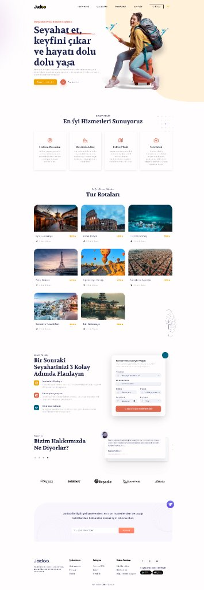
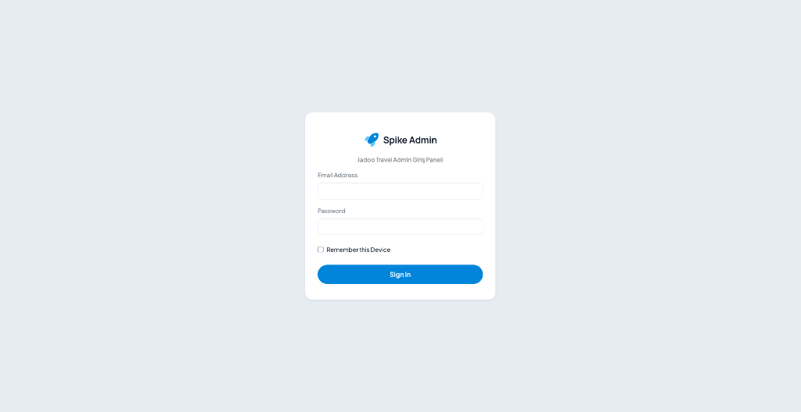
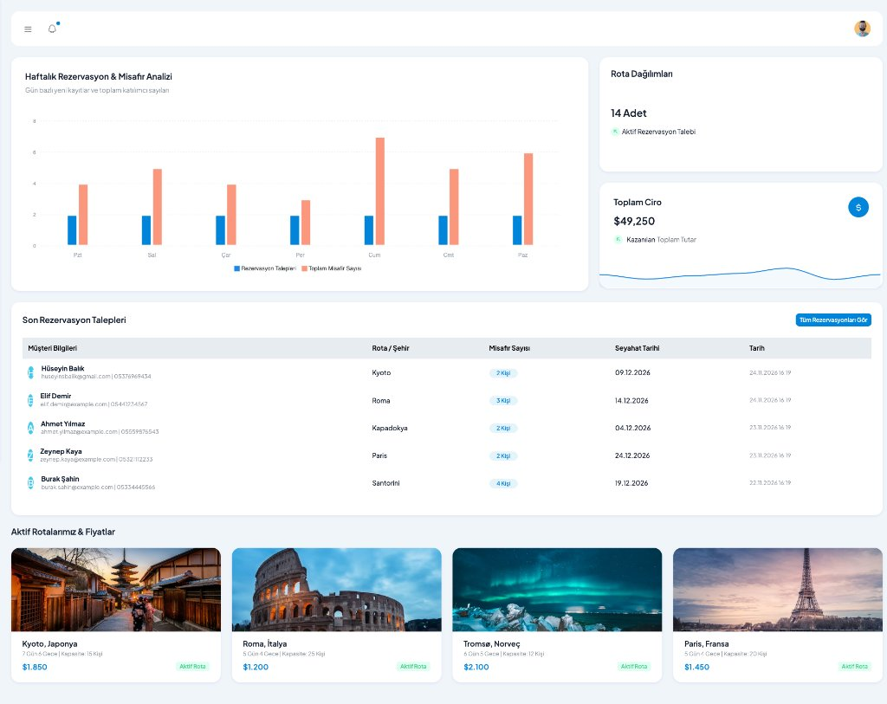
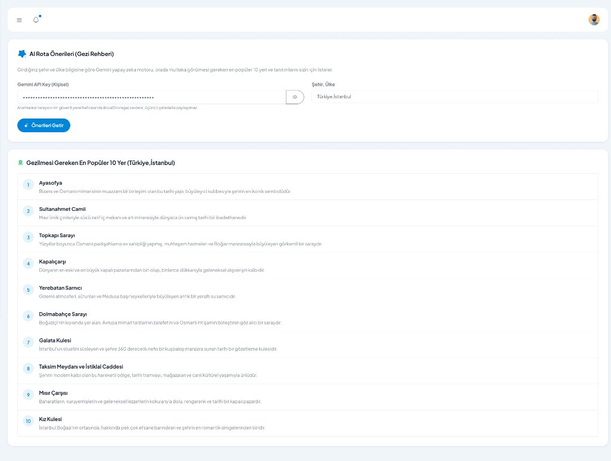
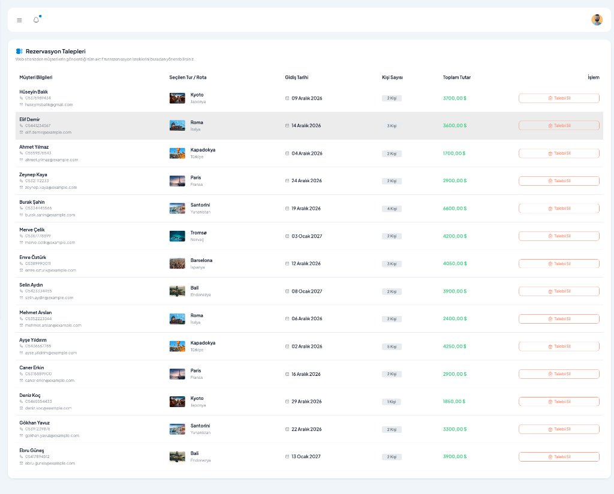
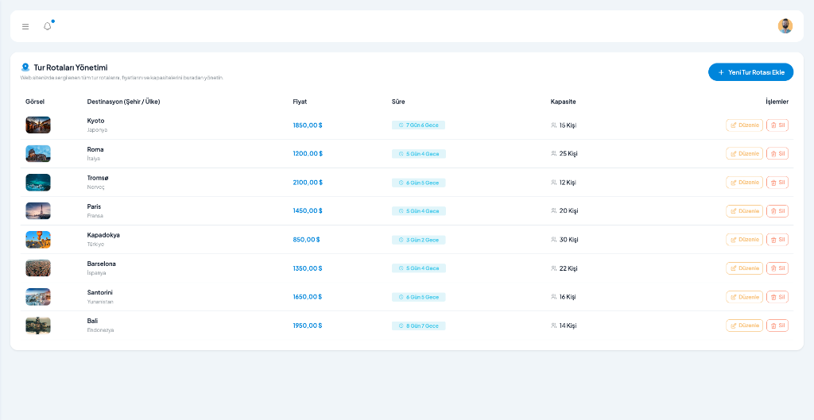
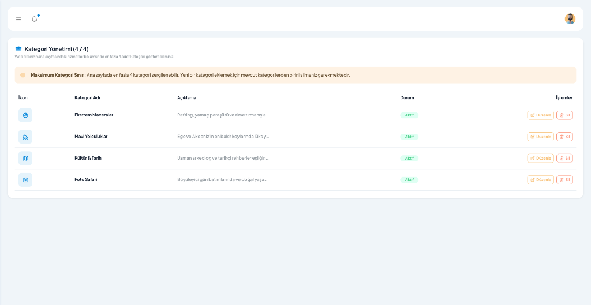
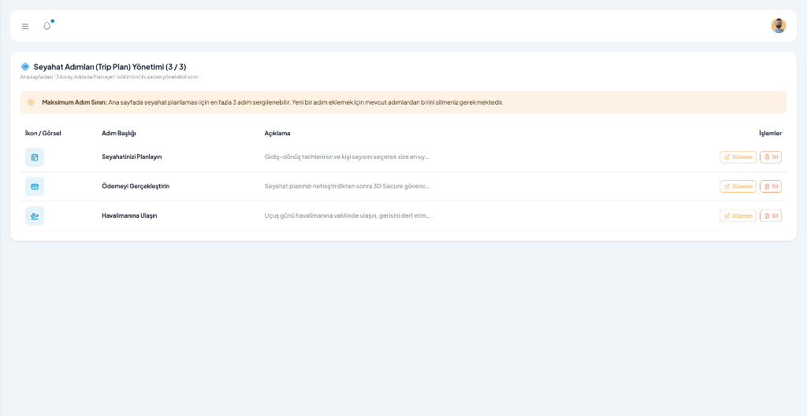
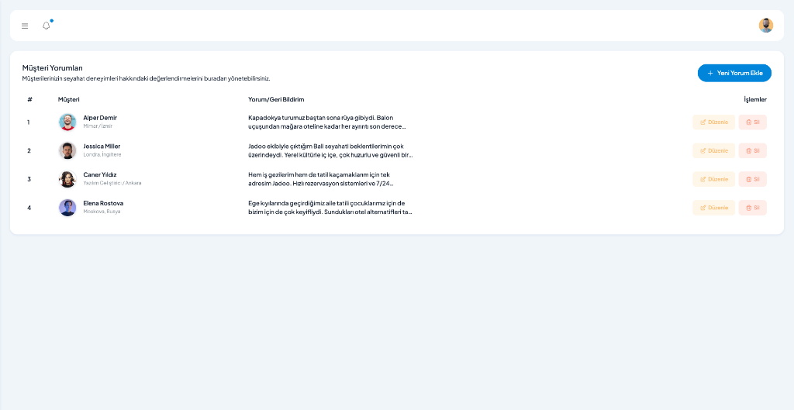
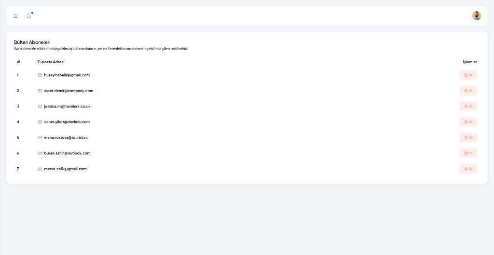

# Jadoo Travel - Modern Seyahat Acentesi ve Yonetim Sistemi

Jadoo Travel; seyahat rotalarinin, hizmet kategorilerinin, musteri degerlendirmelerinin, seyahat planlama adimlarinin ve rezervasyon taleplerinin yonetildigi, MongoDB NoSQL veritabani mimarisine ve Google Gemini Yapay Zeka entegrasyonuna sahip kurumsal bir seyahat acentesi yonetim platformu ve web uygulamasidir.

---

## One Cikan Ozellikler

### 1. Canli Veri Destekli Dinamik Yonetim Paneli (Dashboard)
* **Haftalik Rezervasyon ve Misafir Analizi (Bar Chart):** Gun bazinda yeni eklenen rezervasyon taleplerini ve toplam katilimci (misafir) sayilarini iliskisel olarak gruplayip analiz eder.
* **Rota Dagilimlari (Donut Chart):** Alinan rezervasyonlarin hangi sehir ve rotalara yapildigini oransal olarak sunar.
* **Toplam Ciro ve Kazanc Trendi (Sparkline Area):** Rezervasyonlardan elde edilen gelirleri ve gunluk ciro artis trendini gorsellestirir.
* **Guncel Talepler ve Populer Turlar:** Veritabanindaki en guncel rezervasyon taleplerini ve one cikan aktif turlari fiyat, kapasite ve sure detaylariyla listeler.

### 2. MongoDB Destekli ASP.NET Core Identity Mimarisi
* **NoSQL Uyumlu Kimlik Dogrulama:** Entity Framework Core (SQL) bagimliligi olmaksizin, `AspNetCore.Identity.MongoDbCore` entegrasyonu ile yerlesik Identity mekanizmasi dogrudan MongoDB uzerinde calisir.
* **Orijinal Spike-Admin Temasi:** Spike-Admin tasarim standartlarina sadik kalinarak hazirlanan modern ve guvenli giris ekrani.
* **Yetkilendirme Katmani (`[Authorize]`):** Yonetim paneline ait tum kritik yonetim controller'lari rol ve yetki kontrolleri ile korunur.
* **Dinamik Profil Yonetimi:** Giris yapan yoneticinin ad, soyad ve e-posta bilgileri navbar uzerindeki profil alanina yansitilir; guvenli cikis (Logout) islemi yonetilir.

### 3. Google Gemini AI Rota Onerileri (Gezi Rehberi)
* **Canli Gemini API Entegrasyonu:** Yoneticilerin girdigi sehir veya ulke bilgisine gore o destinasyonda mutlaka gorulmesi gereken en populer 10 mekani ve detayli Turkce tanitimlarini anlik olarak uretir.
* **Yapilandirilmis JSON Ciktisi:** Gemini modelinden gelen cok parcali (streaming parts) yanitlar guvenli bir sekilde birlestirilerek temiz nesne dizisi olarak islenir ve arayuzde dinamik kartlar seklinde gosterilir.
* **Kisisel API Anahtari Yonetimi:** Kullanicilar kendi API anahtarlarini tarayicinin yerel hafizasinda (localStorage) saklayabilir veya merkezi konfigurasyon anahtarini kullanabilir.

### 4. Canli Bildirim Merkezi (Navbar Notification Bell)
* Sisteme yeni bir rezervasyon dustugunde sag ust kosedeki bildirim zili uzerinde dinamik kirmizi bildirim rozeti goruntulenir.
* Acilir pencerede en son alinan rezervasyonlarin musteri, tarih ve rota bilgileri ozet olarak sunulur; tek tikla rezervasyon detayina gidilebilir.

### 5. Yapay Zeka Destekli Coklu Dil Altyapisi (Batch Translation)
* Sozluk anahtarlarini sayfalarin ilk render aninda toplayip 300 ms gecikmeli kuyrukta biriktirerek tek bir API cagrisiyla Gemini uzerinden topluca Turkce, Ingilizce, Ispanyolca ve Fransizca dillerine ceviren yuksek performansli toplu cevirim servisi kurulmustur.

---

## Ekran Goruntuleri (Screenshots)

### 1. Ziyaretci Ana Sayfasi (Vitrin)


### 2. Yonetim Paneli Giris Ekrani (Sign In)


### 3. Dinamik Yonetim Paneli (Dashboard)


### 4. Google Gemini AI Rota Onerileri (Gezi Rehberi)


### 5. Rezervasyon Talepleri Yonetimi


### 6. Tur Rotalari ve Lokasyonlar Yonetimi


### 7. Hizmet Kategorileri Yonetimi


### 8. Seyahat Plani Adimlari Yonetimi


### 9. Musteri Degerlendirmeleri Yonetimi (Testimonials)


### 10. E-Bulten Aboneleri Listesi


---

## Teknolojiler ve Mimari

* **Framework:** .NET 10.0 / ASP.NET Core MVC (C#)
* **Veritabani:** MongoDB (NoSQL)
* **Veritabani Surucusu:** MongoDB.Driver (3.10.0)
* **Kimlik ve Guvenlik:** AspNetCore.Identity.MongoDbCore (7.0.0), Cookie Authentication
* **Yapay Zeka:** Google Gemini API (v1 / `gemini-3.5-flash-lite`)
* **Nesne Donusumu:** AutoMapper (14.0.0)
* **Veri Gorsellestirme:** ApexCharts JavaScript Kutuphanesi
* **Arayuz Temasi:** Spike-Admin Bootstrap 5 Yonetim Temasi ve Jadoo Landing Page

---

## Kurulum ve Calistirma

### 1. MongoDB Ayarlari
`JadooTravel/JadooTravel/appsettings.json` dosyasini acarak `DatabaseSettingsKey` bolumundeki baglanti adresini kendi yerel veya uzak MongoDB sunucunuza gore duzenleyin:

```json
"DatabaseSettingsKey": {
  "ConnectionString": "mongodb://localhost:27017",
  "DatabaseName": "JadooTravelDb",
  "CategoryCollectionName": "Categories",
  "DestinationCollectionName": "Destinations",
  "FeatureCollectionName": "Features",
  "TripPlanCollectionName": "TripPlans",
  "TestimonialCollectionName": "Testimonials",
  "PartnerCollectionName": "Partners",
  "SubscribeCollectionName": "Subscribes",
  "BookingCollectionName": "Bookings"
}
```

### 2. Gemini API Anahtari (Opsiyonel)
Yapay zeka rota onerisi ve coklu dil destegi icin `appsettings.json` veya User Secrets uzerinden anahtarinizi tanimlayabilirsiniz:

```json
"GeminiApiKey": "YOUR_GEMINI_API_KEY"
```

### 3. Uygulamayi Baslatma
Terminal uzerinden ana proje dizininde asagidaki komutu calistirarak projeyi baslatin:

```bash
dotnet run --project JadooTravel/JadooTravel.csproj
```

Uygulama varsayilan olarak `http://localhost:5203` adresinde calisacaktir.
